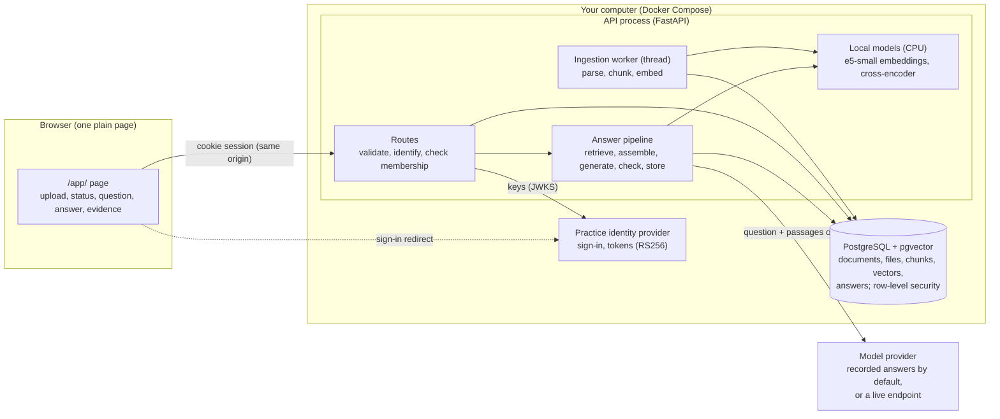
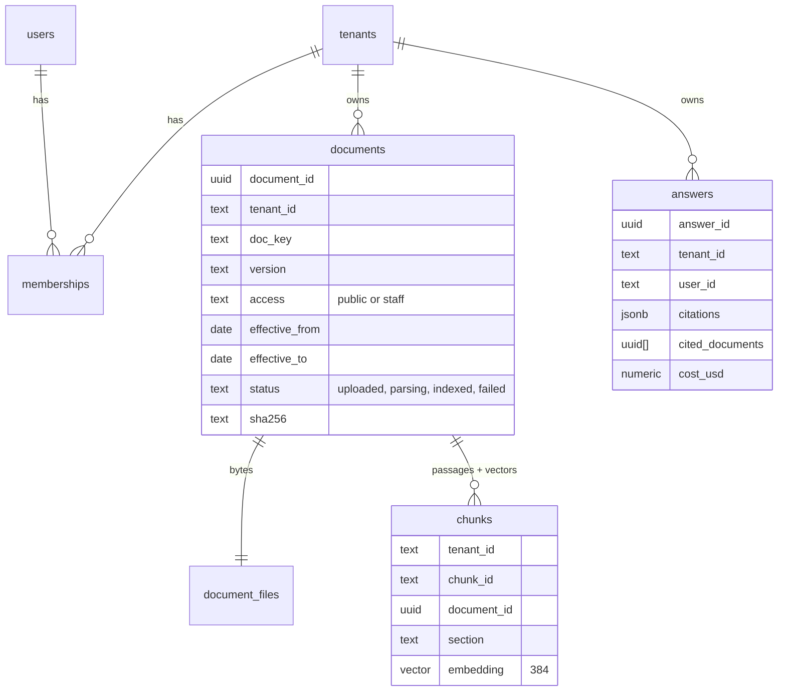
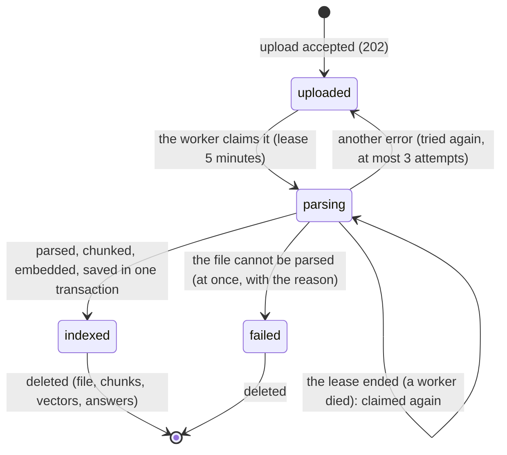

# Architecture and contracts

Sam's design pack, Module 2. Reviewed by Kwame (architecture) and Mei (ingestion and deletion) before any integration was built.

## Components

| Component | Its one job | It must never |
|---|---|---|
| Page | let a member upload, follow the status, ask, read the evidence | put server text on the page as HTML; keep a token |
| Routes | check the request, the caller and their membership; call one service | trust a shop or a role sent by the browser |
| Answer pipeline | turn one question into a stored, cited answer | search another shop; send anything but the question and the passages to the model |
| Ingestion worker | index uploaded documents, one at a time | lose a document: a failure ends as `failed` with a reason |
| PostgreSQL | keep every shop's data, separated by `tenant_id` and row-level security | let a query of one shop see another shop's rows |
| Model provider | write an answer from the passages | receive a document that the caller may not read |

## Contracts

All paths of shop data start with `/v1/tenants/{tenant}`. The shop in the path is only a request: the membership decides. Every error has one shape: `{"code", "message", "request_id"}` (+ `details` for a validation error).

| Method and path | Who may call it | Request | Success | Errors |
|---|---|---|---|---|
| `POST /v1/tenants/{t}/documents` | owner, staff | multipart: `file`; optional `access`, `version`, `title`, `effective_from`, `effective_to`, `doc_key`, `doc_type` | 202 `{document, duplicate: false}` + `Location`; 200 `{document, duplicate: true}` for the same file again | 401, 403, 404, 409 `conflict`, 413 `file_too_large`, 415 `unsupported_file`, 422 |
| `GET /v1/tenants/{t}/documents` | every member | | 200 `{documents, counts}` (read-only members see public documents only) | 401, 404 |
| `GET /v1/tenants/{t}/documents/{id}` | every member | | 200 `{document}` with `status`: uploaded, parsing, indexed or failed (+ `error`) | 401, 404 |
| `DELETE /v1/tenants/{t}/documents/{id}` | owner, staff | | 200 `{deleted: {chunks, answers}}` | 401, 403, 404 |
| `POST /v1/tenants/{t}/answers` | every member | `{"question": 3-500 characters, "as_of": "YYYY-MM-DD" (optional)}` | 200 `{answer: {answerable, answer, claims: [{text, citations, problems}], passages, needs_review, provider, model, tokens, cost_usd, latency_ms, trace_id}}` | 401, 404, 422, 429 `limit_reached`, 502 `provider_bad_answer`, 503 `provider_unavailable`/`provider_busy`, 504 `provider_timeout` |
| `GET /v1/tenants/{t}/answers`, `/answers/{id}` | the member who asked | | 200 | 401, 404 |
| `GET /v1/tenants/{t}/chunks/{chunk_id}` | every member (access level applies) | | 200 `{chunk}`: the evidence behind a citation | 401, 404 |
| `GET /v1/me` | anyone signed in | | 200 `{user, memberships}` | 401 |
| `GET /health`, `GET /ready` | anyone | | 200 | 503 `not_ready` |

## Data model

Every table with shop data has `tenant_id`, and every key that points at another row includes it (a chunk cannot belong to another shop's document). Migrations: `001_core.sql` (this module), then `002` row-level security, `003` duplicate-safe ingestion, `004` keyword search, `005` usage limits.

## Ingestion states

What the user sees: `uploaded` and `parsing` as "indexing" (the page asks again every 1.5 seconds), `indexed` with the number of passages, `failed` with the reason ("This file is not a readable PDF").

## Retrieval metadata

Each chunk is one section of one document version (the RAG course's structure chunker), and starts with the document title. The search filters BEFORE taking the top 5: the shop (`tenant_id`), the access level (a read-only member gets public documents only), the date (`effective_from <= as_of <= effective_to`), and the embedding model (`documents.embedder`). Each passage given to the model has a header: `[chunk_id] title | type, version, in force from ... to ... | section`.
