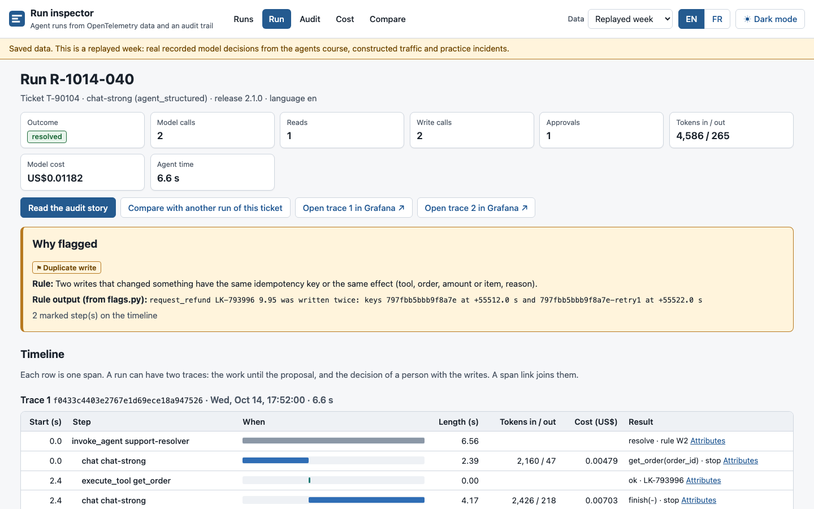

# The run inspector

The run inspector is a small app that shows the runs of an AI agent. It reads standard OpenTelemetry data and an audit trail. It shows five screens: **Runs**, **Run**, **Audit**, **Cost** and **Compare**.

Use it to see what a view made for agent runs adds to Grafana and Langfuse.



## What it is, and what it is not

The inspector is:

- **A reader of OpenTelemetry data.** It reads spans with the GenAI semantic conventions and the course's audit events. It has no SDK of its own.
- **Free, and on your computer.** It reads the same Tempo, Prometheus and audit store that you use in the course. It also opens on saved data, with no setup.
- **Read-only.** It never writes to a system. It answers only `GET` requests.
- **Small.** One Python package, standard library only, and web pages that are already built.

The inspector is not a product. It does not have evaluations, datasets, a prompt playground, user accounts, alerts or live tailing. For alerts, use Grafana.

**The saved data** is a replayed week: real recorded model decisions from the agents course, constructed traffic and practice incidents. The constructed run says "constructed" on each screen.

## Start it

You need Python 3.12 or later. You do not need Node.js or npm: the web pages are already built (`web/dist/`).

### With pip or uvx

From this folder:

```sh
python -m pip install .
larkfield-inspector
```

Or, with [uv](https://docs.astral.sh/uv/), with no install:

```sh
uvx --from . larkfield-inspector
```

Or, with no install at all:

```sh
python -m larkfield_inspector
```

The command shows the address and opens your browser:

```text
Run inspector 1.0.0 on http://127.0.0.1:8318/ (saved mode: the built-in replayed week).
The saved data is a replayed week: real recorded model decisions from the agents course, constructed traffic and practice incidents. No data leaves this computer.
Press Ctrl+C to stop.
```

Add `--no-browser` if you do not want the browser to open. Press **Ctrl+C** to stop the inspector.

On Windows (PowerShell), use the same commands. If `python` is not found, use `py -3.12 -m larkfield_inspector`.

### With Docker

```sh
docker build -t larkfield-inspector .
docker run --rm -p 127.0.0.1:8318:8318 larkfield-inspector
```

Then open http://127.0.0.1:8318/ in your browser. Inside the container the inspector listens on all addresses (`INSPECTOR_HOST=0.0.0.0`). The `-p 127.0.0.1:8318:8318` option keeps the port on your computer only.

## Saved mode and live mode

**Saved mode** is the default. The inspector opens on its built-in data. Use the **Data** list at the top to change the data set:

| Data set | What it is |
|---|---|
| Replayed week | The runs of the support agent in one week, with the practice incidents |
| Healthy week | The same tickets with a healthy release: no flag must fire |
| Constructed run | One constructed run: a scripted model followed an injected instruction |

To open your own saved telemetry (a folder with `traces.jsonl` or `traces.jsonl.gz`, and optionally `audit.jsonl`), add `--data`:

```sh
larkfield-inspector --data work/telemetry
```

**Live mode** reads your running stack. It sends only `GET` requests:

```sh
INSPECTOR_MODE=live AUDIT_STORE=work/audit/audit.jsonl larkfield-inspector
```

On Windows (PowerShell):

```powershell
$env:INSPECTOR_MODE = "live"; $env:AUDIT_STORE = "work\audit\audit.jsonl"; larkfield-inspector
```

In live mode the inspector:

1. Searches Tempo with TraceQL: `GET /api/search?q=...&start=...&end=...&limit=...`. The default query finds the root spans of runs and of decisions: `{ span.gen_ai.operation.name =~ "invoke_agent|invoke_workflow|approve" }`.
2. Gets each trace by its ID: `GET /api/traces/<trace ID>`. It accepts OTLP JSON with hex or base64 IDs, and the `batches` and `resourceSpans` shapes.
3. Groups the spans into runs and computes the five flags with the same code as saved mode.
4. Reads the audit store file (`AUDIT_STORE`) for the Audit screen.
5. Asks Prometheus for the cost per hour (`GET /api/v1/query_range`), and shows the total on the Cost screen.

The built-in data sets stay in the **Data** list in live mode. If Tempo does not answer, the inspector shows the error and the built-in data still works.

## Settings (environment variables)

| Variable | Default | What it does |
|---|---|---|
| `INSPECTOR_PORT` | `8318` | The port (also `--port`) |
| `INSPECTOR_HOST` | `127.0.0.1` | The address to listen on (also `--host`). Keep `127.0.0.1`: this computer only |
| `INSPECTOR_MODE` | `saved` | `saved` or `live` (also `--mode`) |
| `INSPECTOR_DATA` | (none) | A folder of your own saved telemetry (also `--data`) |
| `INSPECTOR_NO_BROWSER` | (none) | `1`: do not open the browser (also `--no-browser`) |
| `TEMPO_URL` | `http://127.0.0.1:3200` | Tempo's HTTP API (live mode) |
| `TEMPO_QUERY` | see above | The TraceQL query of the search (live mode) |
| `TEMPO_LIMIT` | `500` | The most traces that one search returns (live mode) |
| `INSPECTOR_LIVE_HOURS` | `168` | How many hours back the search looks (live mode) |
| `INSPECTOR_LIVE_TTL` | `30` | Seconds before the inspector asks Tempo again (live mode) |
| `PROMETHEUS_URL` | `http://127.0.0.1:9090` | Prometheus's HTTP API (live mode) |
| `PROMETHEUS_COST_QUERY` | `sum(increase(larkfield_run_cost_total[1h]))` | The PromQL query of the cost per hour (live mode) |
| `AUDIT_STORE` | (none) | The audit store file, for example `work/audit/audit.jsonl` (live mode) |
| `GRAFANA_URL` | `http://127.0.0.1:3031` | Grafana, for the "Open trace in Grafana" links |
| `GRAFANA_TEMPO_UID` | `tempo` | The UID of the Tempo data source in Grafana |
| `LANGFUSE_URL` | (none) | Your Langfuse project's address, for example `https://cloud.langfuse.com/project/<project ID>`. If it is not set, the Langfuse link is not shown |
| `INSPECTOR_BUDGET_USD` | `0.002` | The budget line on the Cost screen, in US dollars per resolved ticket |
| `OBS_TZ_OFFSET` | `-4` | The hours from UTC for the times (Larkfield: Toronto in October), as the course's `obs` tool |

## The five screens

1. **Runs.** A table of runs: ticket, start time, outcome, model steps, tool calls, approvals, cost, duration, model and flags. Filter by outcome, flag, model, language (the slice), day, cost range, or a run or ticket. Select a flag count to show only those runs.
2. **Run.** The timeline of one run. Each row is one span: agent, model and tool steps, with the tokens and the cost of each model step. An approval pause shows the waiting time and the approver. Errors and retries have labels. **Why flagged** shows the rule and the rule's own sentence, and the timeline marks the steps that the flag talks about. Links open the same trace in Grafana (and in Langfuse if you set `LANGFUSE_URL`).
3. **Audit.** The run as a story, for people outside engineering. It uses the audit trail only: who asked, what the agent read (orders and policy passages, as IDs, not text), what it proposed, who approved (person, role, limit), what changed, and if the trail verifies (the hash chain and the anchor). **Download Markdown** gives the story for an auditor. **Print or save as PDF** uses your browser's print with a print layout.
4. **Cost.** Cost per resolved ticket per day or per hour, with the budget line (US$0.002 per resolved ticket, an assumption: Omar's budget) and the releases. Select a bar to see its runs on the Runs screen. Tables show the cost by model, language, outcome, release and model step, and the 10 most expensive runs. The prices come from the dated price table on each model span (`larkfield.price_table`). They are the course's prices, not the prices of your provider today.
5. **Compare.** Two runs of one ticket, side by side, with the steps aligned. The first difference is marked: a model decision, a tool result or an approval.

The screens have English and French labels (**EN** / **FR**), a light and a dark mode (**Dark mode**, or your system's setting), and work with the keyboard and screen readers. The Markdown export is in English: it is the text of the course's `obs` tool.

## How one flag is computed

The five flags are short functions in `larkfield_inspector/vendor/obs/flags.py`. This file is a copy of the course project's `obs/flags.py`, so the inspector and `python -m obs find` always agree. For example, the **duplicate write** rule:

1. Take the run's writes that changed something: the write answered `done`, or it timed out and no later check found that it did not happen.
2. Two of these writes with the same idempotency key, or with the same effect (tool, order, amount or item, reason), make the flag.
3. The rule returns a sentence that says why, with the times of the two writes. The Run screen shows this sentence.

| Flag | The rule |
|---|---|
| Loop | The model asks for the same tool with the same argument names 3 or more times in one run, or a loop limit stops the run |
| Hidden tool error | A tool call failed, no later call of that tool succeeded, and the ticket was closed as resolved |
| Duplicate write | Two writes that changed something have the same idempotency key or the same effect |
| No action | The ticket was closed as resolved, but nothing was written and no reply was sent |
| Followed injection | After a step whose input carried an injected instruction (the practice data's marker), a write did what the instruction asked |

On the replayed week, every scenario run has its flag. Two flags fire on runs that the scenario list does not count as harmful: a return label written twice after a timeout (duplicate write), and a second hidden error by the local model (hidden tool error). Open them on the Runs screen with the flag filter and decide for yourself.

The followed injection flag works only with the practice data: real systems cannot know which input carried an injected instruction.

## The API

All answers are JSON, except the Markdown export. Add `ds=<data set>` to choose the data set (`week`, `healthy-week`, `constructed`, `live`, `yours`; the default is the first one).

| Request | Answer |
|---|---|
| `GET /api/info` | Version, mode, data sets, flag names, budget, time offset, which links exist |
| `GET /api/runs` | The runs table. Filters: `outcome`, `flag` (a flag name, `any` or `none`), `model`, `language`, `release`, `ticket`, `min_cost`, `max_cost`, `from`, `to` (milliseconds since 1970, or ISO 8601), `q` (part of a run or ticket ID). Sort: `sort=start\|cost\|duration\|steps`, `order=asc\|desc` |
| `GET /api/runs/<run>` | One run (a run ID, a trace ID or a ticket): its traces with their spans, the waits for a person, the flags with "why" and the marked spans, the links, the price table dates, the other runs of the same ticket |
| `GET /api/runs/<run>/audit` | The audit records of the run, with the story sentence of each record, the facts of the story and the result of the chain check |
| `GET /api/runs/<run>/audit.md` | The audit story as a Markdown file (a download) |
| `GET /api/cost` | Cost per resolved ticket per `bucket=day\|hour`, filtered by `model`, `language`, `outcome`, `release`; totals; cost by model, language, outcome, release and model step; the 10 most expensive runs; the budget; the price tables; the releases. In live mode, also the Prometheus series |
| `GET /api/compare?a=<run>&b=<run>` | Two runs with the steps aligned and the first difference. Without `a` and `b`: two runs of the double-refund ticket, or of another ticket with two runs |
| `GET /api/refresh` | Live mode: ask Tempo again on the next request |

Example:

```sh
curl "http://127.0.0.1:8318/api/runs?flag=duplicate_write"
curl -O -J "http://127.0.0.1:8318/api/runs/R-1014-040/audit.md"
```

## Privacy

- The inspector listens on `127.0.0.1` only (this computer), unless you change `INSPECTOR_HOST`.
- No data leaves your computer. The inspector sends requests only to the Tempo and Prometheus addresses that you give it, and only in live mode.
- The inspector has no telemetry of its own, no analytics and no request log.
- The web pages load nothing from the internet: no fonts, no scripts, no images from other sites.

## The files

| Path | What it is |
|---|---|
| `larkfield_inspector/` | The Python package: the HTTP server (`server.py`), the data sources (`sources.py`), the JSON views (`views.py`) |
| `larkfield_inspector/vendor/` | Copies of the course project's `obs/model.py`, `obs/flags.py`, `obs/story.py`, `auditstore/store.py`, `auditstore/schema.py` and `data/people.json`. Do not change them here |
| `larkfield_inspector/data/` | The built-in saved data: `week`, `healthy-week`, `constructed` |
| `sync.py` | Copies the files above from the course project again (`python sync.py`); `python sync.py --check` compares them |
| `web/src/` | The web pages' source: React and TypeScript, built with Vite |
| `web/dist/` | The built web pages (the server serves them) |
| `tests/` | The tests (pytest) |
| `Dockerfile` | One image with Python 3.12 (slim) |

To run the tests: `python -m pip install pytest` and then `python -m pytest`. The test of the copies needs the course project beside this folder (`../project` or `../snapshots/end-of-m08`), or set `INSPECTOR_PROJECT`. Without it, that test is skipped.

To build the web pages again (only if you change `web/src/`): in `web/`, `npm install` and `npm run build`. You need Node.js 24.

## Licence

MIT. See `LICENSE`.
